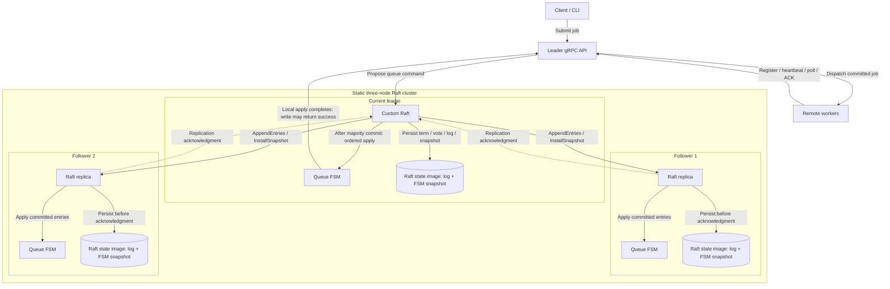

# Raft Recovery

[中文](README.zh-CN.md) · [Implementation audit](docs/reports/PHASE3_DELIVERY.md) · [Documentation](docs/README.md)

A Go job queue built in three stages: durable local execution, remote workers over gRPC, and a replicated queue using a custom Raft implementation. This is an educational systems project with tested recovery paths, not a production service.

## Current capabilities

- **Phase 1:** checksummed full-job WAL records, synchronous durability acknowledgements, snapshots, replay, timeout/retry and dead letters.
- **Phase 2:** protobuf/gRPC submission, registration, heartbeat leases, remote polling and attempt-fenced acknowledgements; workers and submitters rotate through master seed addresses.
- **Phase 3:** randomized elections, persistent term/vote/log, log freshness voting, majority replication, conflict repair, current-term commit rule, ordered state-machine application, durable snapshots, log compaction and InstallSnapshot catch-up.
- Queue ENQUEUE, DISPATCH, ACK and TIMEOUT all go through Raft in master mode. A successful write response waits for majority commit and local application. Followers reject queue operations with a leader hint.
- Snapshots preserve FIFO order, active jobs, complete dead letters and completed-job tombstones. Retrying a job ID does not enqueue another job, including after compaction/restart. IDs must identify the same logical request; a duplicate does not replace its payload.

The default executor is a **simulation** (`sleep_ms` and optional failure), suitable for demonstrations. Applications need their own executor and external idempotency strategy. Worker delivery is **at least once**: fencing protects queue state, but cannot undo an external effect performed before a crash.

## Architecture



**Write path:** ENQUEUE, DISPATCH, ACK and TIMEOUT are replicated commands. Success waits for **majority commit and local FSM application**. Each node restores its FSM from its persisted snapshot and committed log suffix.

**Failover:** peers elect a new leader using RequestVote; the roles above can move between nodes. Clients and workers rotate through seed addresses and reconnect. Registration and heartbeats are rebuildable soft state; job ownership and attempts are replicated. Worker execution remains **at least once**.

The diagram shows **master mode**. Standalone mode uses a separate WAL + snapshot recovery path.

## Run a real three-master cluster

Requires Go 1.23+; committed protobuf bindings mean `protoc` is only needed when changing the schema.

```bash
go build -o bin/beaver-raft ./cmd/queue
```

Open three terminals. All nodes use the same complete static membership list; IDs are routable addresses. Each node has its own durable data directory.

```bash
# Terminal 1
./bin/beaver-raft --config configs/cluster.yaml run --mode master \
  --port 50051 --listen 127.0.0.1:50051 --node-id 127.0.0.1:50051 \
  --peers 127.0.0.1:50051,127.0.0.1:50052,127.0.0.1:50053 --data-dir data/node1

# Terminal 2
./bin/beaver-raft --config configs/cluster.yaml run --mode master \
  --port 50052 --listen 127.0.0.1:50052 --node-id 127.0.0.1:50052 \
  --peers 127.0.0.1:50051,127.0.0.1:50052,127.0.0.1:50053 --data-dir data/node2

# Terminal 3
./bin/beaver-raft --config configs/cluster.yaml run --mode master \
  --port 50053 --listen 127.0.0.1:50053 --node-id 127.0.0.1:50053 \
  --peers 127.0.0.1:50051,127.0.0.1:50052,127.0.0.1:50053 --data-dir data/node3
```

In another terminal, start a worker and submit jobs:

```bash
./bin/beaver-raft --config configs/cluster.yaml run --mode worker \
  --master 127.0.0.1:50051,127.0.0.1:50052,127.0.0.1:50053

./bin/beaver-raft --config configs/cluster.yaml enqueue --file test/demo-jobs.json \
  --master 127.0.0.1:50051,127.0.0.1:50052,127.0.0.1:50053
```

Master logs identify the elected leader. Kill that process and watch another master win election while workers reconnect. Restart with the **same ID, membership and data directory** to recover. Do not run two processes against one data directory. Losing two of three masters prevents new commits.

For an automated abrupt leader-loss demonstration:

```bash
./scripts/demo-three-node-failover.sh
```

The script uses temporary node directories, kills the elected leader with SIGKILL, and checks worker ACKs. It is a smoke test, not a latency benchmark. For standalone mode, use `run --mode standalone` and omit `--master` on enqueue; offline enqueue requires the running process to be stopped before modifying its WAL.

## Verify

```bash
go test ./...
go test -race ./...
go vet ./...
go test ./test/integration -run TestRaftClusterDurableFailover -count=3
```

The integration test uses real gRPC connections and covers follower rejection, worker/attempt fencing, leader loss, replica restart, all-node disk recovery, snapshot tombstones and refusal to commit without quorum. See the delivery report for measured verification and remaining gaps.

## Design and limits

- **Static membership only.** IDs and peer transport addresses are the same value. No joint consensus, automatic member replacement, pre-vote or check-quorum.
- **Durable prototype storage.** Raft atomically replaces a JSON state image with file/directory fsync before acknowledging persistence. This costs O(retained log + snapshot size) per mutation; it is not the segmented Raft WAL originally proposed. Local WAL is a separate standalone recovery path.
- **Compact queue checkpoints.** Completed payloads are discarded but tombstones remain; their memory/disk growth is unbounded. This is not a faithful implementation of the [OSDI 2024 Beaver protocol](https://www.usenix.org/conference/osdi24/presentation/yu), which coordinates partial snapshots under external traffic.
- **No measured production guarantees.** Historical targets such as recovery under 3 seconds, 40% smaller snapshots, 30–50% faster recovery and particular throughput are goals until benchmarked with reproducible workloads. There is no arbitrary external exactly-once guarantee.
- Worker registration is rebuildable soft state, rather than another replicated command. Dispatch ownership and attempts are durable. Metrics/CLI status do not yet provide a complete live cluster monitoring interface.
- No TLS/authentication, bounded retention, automatic corrupt-state repair, deployment orchestration or proven linearizable query API. Use only trusted networks for the demo.

For the theory behind the consensus rules, see the [Raft paper](https://raft.github.io/raft.pdf). Original phase documents under `docs/phases/` and `docs/planning/` preserve historical intent; the current behavior and deviations are recorded in [the delivery audit](docs/reports/PHASE3_DELIVERY.md).
