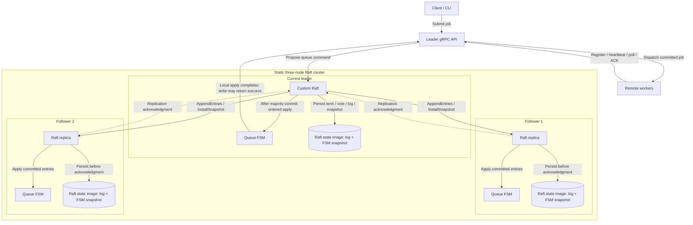

# Raft Recovery

[English](README.md) · [實作盤點](docs/reports/PHASE3_DELIVERY.zh-CN.md) · [文件](docs/README.md)

這是一個以 Go 實作的工作佇列，從單機持久化、gRPC 遠端 worker，逐步做到自製 Raft 的多節點複寫。定位是可驗證恢復流程的系統工程作品；正式上線能力仍有待補足。

## 目前功能

- **Phase 1：** 包含完整工作資料與 checksum 的 WAL、同步持久化回覆、快照、重播、逾時重試與 dead letter。
- **Phase 2：** protobuf/gRPC 提交、worker 註冊、heartbeat lease、遠端拉取、含 attempt 驗證的 ACK；worker 與提交端可輪替多個 master seed。
- **Phase 3：** 隨機選舉、term/vote/log 持久化、日誌新舊比較、多數複寫、衝突修復、當前 term 提交規則、按序套用 FSM、持久化快照、日誌壓縮及 InstallSnapshot 追趕。
- master 模式的 ENQUEUE、DISPATCH、ACK、TIMEOUT 都經過 Raft。寫入成功要等多數提交及本機 FSM 套用；follower 拒絕佇列操作並提供 leader 提示。
- 快照保留 FIFO 順序、活動工作、完整 dead letter 與已完成工作的 tombstone。相同 ID 重送不會再次入列，壓縮與重啟後也相同。ID 必須代表同一個邏輯請求；重送不會替換原 payload。

預設 executor 是以 `sleep_ms` 和失敗模擬展示流程的程式。接入實際業務時需提供 executor，並讓外部寫入具有冪等性。工作交付採 **at least once**；attempt fencing 保護的是佇列狀態，無法撤銷 worker 在當機前已造成的外部副作用。

## 使用 OrbStack 執行與測試

安裝 OrbStack 並取得此 repo 後，統一使用 `./raftctl`。Go 編譯、相依套件、測試與執行資料都留在 Linux 容器內，macOS 不需安裝 Go 或 protoc。

```bash
./raftctl doctor
./raftctl setup                    # 在 OrbStack 建置程式與開發工具
./raftctl up                       # 啟動三個 master 與遠端 worker
./raftctl enqueue test/jobs.json
./raftctl status
./raftctl test                     # 全套測試、race、vet 與跨容器恢復測試
./raftctl down                     # 停止服務，保留佇列資料
```

`./raftctl e2e` 可單獨執行隔離的跨容器故障測試；`./raftctl logs` 查看服務紀錄。`./raftctl reset --yes` 刪除本專案佇列資料；`./raftctl purge --yes` 另外移除本專案工具快取與映像。兩者都不會執行全域 Docker prune。

預設明確使用 `orbstack` Docker context；每個 master 有自己的資料卷，E2E 另用隔離的 Compose project。這是在單一 Linux VM 中運作的本機容器叢集。詳細操作、持久化與清理方式見 [OrbStack 管理指南](docs/guides/ORBSTACK.zh-CN.md)。

## 系統架構



**寫入流程：** ENQUEUE、DISPATCH、ACK、TIMEOUT 都是複寫指令。成功回覆須等到**多數提交及本機 FSM 套用**。每個節點以持久化快照與已提交的日誌後綴還原 FSM。

**故障接手：** 節點以 RequestVote 選出新 leader；圖中的角色會隨選舉改變。client 與 worker 輪替 seed 位址並重新連線。註冊與 heartbeat 是可重建的 soft state；派工歸屬與 attempt 則經過複寫。worker 執行語意仍是 **at least once**。

圖示為 **master 模式**；單機模式另採 WAL＋快照恢復。

## 主機原生三節點指令（選用參考）

建議使用上方不需主機 Go 的 OrbStack 流程。以下原生指令保留給已備妥 Go 1.23+ 的其他環境參考；protobuf 產物已提交，只有修改 schema 才需要 `protoc`。

```bash
go build -o bin/beaver-raft ./cmd/queue
```

分別在三個終端執行。三個節點的靜態成員名單相同，ID 是可連線的位址，各自使用獨立資料目錄。

```bash
# 終端 1
./bin/beaver-raft --config configs/cluster.yaml run --mode master \
  --port 50051 --listen 127.0.0.1:50051 --node-id 127.0.0.1:50051 \
  --peers 127.0.0.1:50051,127.0.0.1:50052,127.0.0.1:50053 --data-dir data/node1

# 終端 2
./bin/beaver-raft --config configs/cluster.yaml run --mode master \
  --port 50052 --listen 127.0.0.1:50052 --node-id 127.0.0.1:50052 \
  --peers 127.0.0.1:50051,127.0.0.1:50052,127.0.0.1:50053 --data-dir data/node2

# 終端 3
./bin/beaver-raft --config configs/cluster.yaml run --mode master \
  --port 50053 --listen 127.0.0.1:50053 --node-id 127.0.0.1:50053 \
  --peers 127.0.0.1:50051,127.0.0.1:50052,127.0.0.1:50053 --data-dir data/node3
```

另一個終端啟動 worker 並提交工作：

```bash
./bin/beaver-raft --config configs/cluster.yaml run --mode worker \
  --master 127.0.0.1:50051,127.0.0.1:50052,127.0.0.1:50053

./bin/beaver-raft --config configs/cluster.yaml enqueue --file test/demo-jobs.json \
  --master 127.0.0.1:50051,127.0.0.1:50052,127.0.0.1:50053
```

從 master 日誌辨認 leader，結束其程序後，可觀察其他 master 選舉及 worker 重新連線。重啟務必使用**相同 ID、成員名單與資料目錄**；不可讓兩個程序共用一個資料目錄。三個 master 若只剩一個，無法提交新工作。

自動執行突然失去 leader 的展示：

```bash
./scripts/demo-three-node-failover.sh
```

腳本使用暫存資料目錄，以 SIGKILL 結束當選的 leader 並檢查 worker ACK；這是 smoke test，並非延遲 benchmark。單機模式使用 `run --mode standalone`，enqueue 不帶 `--master`；離線 enqueue 寫入 WAL 前，必須先停止正在使用該 WAL 的程序。

## 驗證

```bash
go test ./...
go test -race ./...
go vet ./...
go test ./test/integration -run TestRaftClusterDurableFailover -count=3
```

三節點整合測試使用真正 gRPC 連線，涵蓋 follower 拒絕寫入、worker/attempt 驗證、leader 故障、節點重啟、全節點磁碟恢復、快照去重與失去多數時不能提交。實際驗證結果及缺口請見實作盤點。

## 設計邊界

- **固定成員。** ID 同時是 peer 連線位址；尚無 joint consensus、自動替換成員、pre-vote 或 check-quorum。
- **先確保持久化正確。** Raft 將 JSON 狀態檔原子替換，並對檔案及目錄 fsync；每次修改的成本為 O(保留日誌＋快照大小)。這與原計畫的分段 Raft WAL 不同；單機 WAL 是另一條恢復路徑。
- **精簡佇列 checkpoint。** 完成工作去除 payload、保留 tombstone，因此資料仍會隨歷史 ID 增長。本專案並未完整重現 [OSDI 2024 Beaver 論文協定](https://www.usenix.org/conference/osdi24/presentation/yu)；原論文處理外部流量下的分散式 partial snapshot。
- **效能目標尚非保證。** 原文件的恢復低於 3 秒、快照減少 40%、恢復加快 30–50% 等數值，仍需可重現 benchmark 支持；也沒有任意外部副作用的 exactly once 保證。
- worker 註冊採可重建 soft state；派工歸屬與 attempt 才持久化。metrics／CLI status 尚非完整線上叢集監控介面。
- 尚無 TLS／認證、有界歷史保留、自動損毀修復、部署編排或已證明的線性一致查詢 API。展示請使用可信任網路。

共識規則參考 [Raft 原論文](https://raft.github.io/raft.pdf)。`docs/phases/` 與 `docs/planning/` 留存原先規劃；目前行為和偏離原計畫之處，以[實作盤點](docs/reports/PHASE3_DELIVERY.zh-CN.md)為準。
