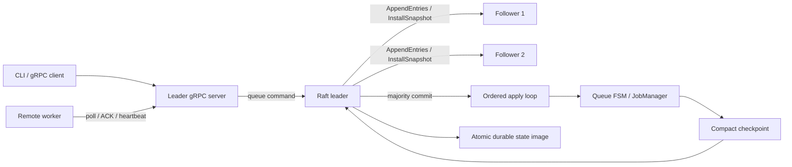

# Raft Recovery: technical and interview guide

[中文](INTERVIEW_GUIDE.zh-CN.md). The [delivery audit](PHASE3_DELIVERY.md) records current behavior; the original phase documents are design history.

## Present the project

**Thirty-second pitch:**

> I built a Go job queue, progressing from WAL/snapshot recovery to gRPC workers and a custom fixed-membership Raft cluster. The main correctness boundary separates receiving a request from safely acknowledging it: queue transitions are majority committed, then applied in order. I validate recovery with leader loss, complete cluster restarts and partitions, while preserving snapshot deduplication and fencing stale worker acknowledgements.

For a two-minute explanation, cover the problem (a durable single master cannot survive machine loss), the design (Raft orders ENQUEUE/DISPATCH/ACK/TIMEOUT; the FSM interprets them), the hard parts (commit versus proposal, deterministic time and snapshot tombstones), the evidence (real gRPC, SIGKILL smoke, disk recovery, partitions and race detector), and the tradeoffs (static membership, whole-image persistence, unbounded tombstones and at-least-once execution).

Do not use historical 1.2-second recovery, 250 jobs/s or 40% snapshot reduction claims without reproducible measurements. Queue deduplication does not establish exactly-once external effects.

## Architecture

| Module | Responsibility | Reading entry point |
|---|---|---|
| CLI | Runtime wiring, member/data paths, seed retry | `internal/cli/cli.go` |
| gRPC server | Leader gate, commit/apply response barrier, leases | `internal/server/server.go` |
| Raft | Terms, votes, election, replication, compaction | `internal/raft/raft.go`, `rpc.go` |
| Durable state | Checksum, temporary file, fsync, rename, directory fsync | `internal/raft/persistent.go` |
| Controller | Ordered apply, timeout proposals, snapshots | `internal/controller/controller.go` |
| JobManager | FIFO, attempts, deterministic transitions | `internal/jobmanager/replicated.go` |
| Workers | Poll, execute, ACK, heartbeat, rotate seeds | `internal/worker/` |
| Standalone recovery | Full-job WAL and snapshot-plus-suffix replay | `internal/storage/wal/`, `internal/snapshot/` |

Raft persistence is authoritative in master mode; WAL plus snapshot is authoritative in standalone mode. Do not replay both paths together. All masters hold FSM state, but only the leader serves queue operations. There is no externally exposed, proven linearizable query API.

## Trace a job

1. The client supplies a stable logical JobID and tries cluster seeds. Followers reject with a leader hint.
2. The leader encodes ENQUEUE with the full job and creation time, persists locally and replicates.
3. Once a durable majority and the current-term commit rule are satisfied, commitIndex advances.
4. The ordered applier updates the FSM. The server waits for this index to be applied before returning success.
5. A registered worker polls. DISPATCH records JobID, WorkerID, next attempt, dispatch time and deadline. No job is handed out before commit/application.
6. ACK carries the same worker and attempt; the FSM accepts only the valid assignment. An identical completion ACK is idempotent, including across compact checkpoints.
7. The leader proposes TIMEOUT for expired assignments. Only its committed application requeues or dead-letters a job.
8. A checkpoint records the applied boundary before log compaction. Lagging followers install the snapshot and then replay the suffix.

A timeout means the outcome is uncertain, not that the request failed to commit. Retry with the same ID. A new ID may create another logical job.

## Explain Raft's safety rules

**Why persist votes?** A restart must not let a node vote twice in the same term. Persist term/vote before granting a vote and persist log entries before acknowledging them. Storage errors fail closed.

**What makes a log fresh?** Compare lastLogTerm first and lastLogIndex second. A shorter log ending in a newer term can be fresher than a longer old-term log. Randomized election deadlines reduce split votes; heartbeats reset follower election deadlines.

**Can two nodes believe they are leader?** Across terms during a partition, yes. This version has no check-quorum. An isolated old leader cannot obtain a majority, so cannot acknowledge new commits. The majority elects a higher-term leader, and the old leader steps down when it learns that term. Leader uniqueness is scoped to a term.

**Why the current-term commit restriction?** A leader directly advances commit using majority replication of an entry in its own term, committing the preceding prefix with it. A new leader appends a no-op to establish this boundary. Use Figure 8 of the Raft paper to explain why merely counting old-term copies is insufficient.

**How are conflicts repaired?** AppendEntries carries prevLogIndex/prevLogTerm. A mismatch returns conflict information so the leader can adjust nextIndex. Only conflicting uncommitted suffixes may be removed; a committed prefix is protected. Per-peer replication is serialized, preventing stale responses from regressing progress.

**Why distinguish commit and apply?** Commit is agreement; apply is the local business effect. Returning after commit alone could make an immediate poll miss the newly submitted job. This server waits for both and verifies proposal index/term identity so a replaced entry cannot be mistaken for success.

## Deterministic state transitions and time

Replicas must not independently call `time.Now()`, generate IDs or perform external I/O inside the FSM. The leader records timestamps, deadlines, attempts, worker identity and retry policy in commands. Every replica interprets the same values.

The leader's clock determines when timeout proposals are issued, so the project does not promise synchronized real-time deadlines. Followers do not independently change state based on their clocks.

Concurrent polls can propose DISPATCH for the same pending head. Only the first command matching the FIFO head and next attempt succeeds; others become no-ops and retry the next head. Reserving only in local memory before replication would make failover harder to reason about.

Worker registration and heartbeat are rebuildable soft state. Workers re-register after failover, avoiding a replicated write per heartbeat. Assignment ownership and attempts remain durable. This deliberately departs from the original REGISTER_WORKER-log plan.

## Deduplication, fencing and delivery semantics

| Mechanism | Protects | Does not protect |
|---|---|---|
| Stable JobID | Submission retry deduplication | A client using a fresh ID for the same action |
| Completed tombstone | Deduplication after compaction | Infinite-history storage growth |
| Worker/attempt fencing | Current queue assignment | External effects already performed by a stale worker |
| Majority commit | State surviving one master failure | Permanent loss of majority disks |
| Atomic local persistence | Partial-state replacement | A device lying about flush or regional disaster |

Example: a worker charges a card, then crashes before ACK. Timeout causes another delivery, which may charge again. Use the same downstream idempotency key, or a shared transaction/inbox/outbox boundary where appropriate. Raft does not make arbitrary external systems part of one transaction.

## Snapshot decisions

- Saving only pending/in-flight jobs would lose dead-letter evidence and completed-ID deduplication.
- Keep complete active/dead jobs, exact FIFO order, compact completed tombstones and lastApplied index. Discard completed payloads.
- Size reduction depends on payload size, active ratio and history. A 40% target requires measurement.
- Tombstones have no TTL. Expiry would define a shorter deduplication contract and require a bounded retry window.
- Persist a snapshot for an exact index before truncating its prefix. Restore snapshot before the committed suffix.
- Standalone snapshot writing and WAL rotation serialize mutations, preventing post-snapshot records from being dropped during rotation.
- This is a queue hot-state checkpoint. The OSDI 2024 Beaver work coordinates distributed partial snapshots under external traffic; this project does not reproduce that protocol.

## Storage decision

The original plan proposed an append-only Raft WAL. This version atomically replaces one image containing term, vote, log, commit boundary and snapshot: temporary write → file fsync → close → rename → directory fsync. Load verifies checksum and index bounds.

The benefit is a simpler crash boundary while establishing consensus/recovery correctness. The cost is O(retained log + snapshot size) per mutation, longer lock holds and write amplification. A later segmented WAL, separate metadata/snapshot files and group commit need their own crash-ordering tests; changing JSON to binary alone does not solve the problem.

The standalone WAL now records complete jobs rather than IDs, covers payload in CRC, recovers sequence on restart and keeps it monotonic across rotation. Corruption/flush errors prevent further successful writes. Legacy ID-only WAL cannot reconstruct missing original business payloads.

## Demonstrate failure scenarios

| Scenario | Expected result | Evidence |
|---|---|---|
| Submit to follower | Reject with leader hint | Real-gRPC integration |
| SIGKILL leader | Majority elects; worker rotates seeds | Demo script |
| Isolate old leader | Proposal times out; uncommitted FSM unchanged | Partition/core and minority integration |
| Conflicting suffix | Higher-term leader repairs it | Core conflict test |
| Lag behind compacted prefix | InstallSnapshot, then suffix | Core snapshot test |
| Restart every node | Restore state and completed-ID dedup | Durable integration |
| Wrong worker/stale attempt ACK | No state change | FSM and gRPC tests |
| Corrupt payload/state | Reject checksum and further writes | WAL/Raft corruption tests |

Tests are evidence, not a proof. Exhaustive state-space exploration, Jepsen, prolonged multi-host soak and power-loss storage fault injection remain future work.

## Resume and interview preparation

Suggested resume line:

> Implemented a durable Go job queue with gRPC workers and custom Raft election/replication; unified enqueue, dispatch, ACK and timeout in a deterministic FSM with checkpoint deduplication, attempt fencing and three-node failure/restart validation.

Before adding performance numbers, record hardware, commit, workload, payload, job count, active ratio, repetitions and p50/p95/p99. Fill in measured results only.

Strong discussion points are concrete counterexamples: enqueue/ACK replication alone misses dispatch/timeout; discarding completed IDs breaks post-restart dedup; an isolated leader is not a successful writer; snapshot/rotation needs a mutation boundary; whole-image persistence trades throughput for a simpler crash boundary.

Prepare to:

1. Draw proposal → commit → apply → execution → ACK without looking at code.
2. Explain why three nodes tolerate one failure and why a minority cannot write successfully.
3. Explain vote freshness, the current-term rule and leader no-op.
4. Distinguish at-least-once, deduplication and fencing using the charging example.
5. List checkpoint contents and justify FIFO/tombstones.
6. Run the demo; read `TestRaftClusterDurableFailover` and the core partition test.
7. Present one unfinished feature with requirements, design, risk and validation.

Next priorities: resource bounds and live observability, persistence benchmarks and efficiency; before deployment, TLS/auth, process directory locks, persisted membership binding and backup policy; then dynamic membership, ReadIndex and deeper fault/model checking.

## References

- [Raft paper](https://raft.github.io/raft.pdf): election, log matching, leader completeness, current-term commit and snapshots.
- [Beaver, OSDI 2024](https://www.usenix.org/conference/osdi24/presentation/yu): distinguish the paper's problem from this queue checkpoint.
- Original plans: `roadmap.md`, `docs/phases/phase2-falconqueue.md`, `docs/phases/phase3-beaver-raft.md`, `docs/planning/PHASE3_IMPLEMENTATION_PLAN.md`.
