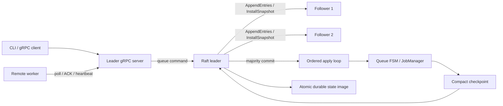

# Raft Recovery：技術理解與面試準備

對照 [English](INTERVIEW_GUIDE.md)。目前功能與缺口以 [Phase 3 交付盤點](PHASE3_DELIVERY.zh-CN.md)為準；原階段文件是設計歷史。

## 先把作品說清楚

**30 秒版本：**

> 我做了一個 Go 工作佇列，從 WAL 與快照的單機恢復，擴展成 gRPC 遠端 worker，再實作固定三節點的 Raft 選舉與複寫。重點是把「收到請求」與「可安全回覆成功」分開：所有佇列狀態轉移都經過多數提交，再按序套用 FSM。我用節點故障、全節點重啟和網路分割測試驗證恢復，同時保留快照去重與舊 ACK 的 fencing。

**兩分鐘版本：**

1. 問題：單機持久化只能處理程序重啟，不能讓另一台機器接手；把 master 複製三份也不等於一致。
2. 方法：leader 排序 ENQUEUE、DISPATCH、ACK、TIMEOUT；Raft 決定哪些指令已提交；FSM 決定工作如何變更。
3. 難點：不可把「提案成功」當「提交成功」；派工、重試與時間也必須複寫；快照丟掉完成工作後，仍要保留 ID 去重。
4. 驗證：真實 gRPC 三節點、SIGKILL leader 展示、磁碟重啟、snapshot catch-up、少數派拒絕提交與 race detector。
5. 取捨：固定 membership；持久層先用原子 JSON image；精簡快照保留 tombstone；交付語意是 at least once。效能目標要另外量測。

不要把尚未量測的 1.2 秒、250 jobs/s 或縮小 40% 放進履歷。也不要把 queue 內部去重包裝成任意業務的 exactly once。

## 系統如何合作

| 模組 | 責任 | 閱讀入口 |
|---|---|---|
| CLI | 組裝執行模式、成員與資料目錄；提交端多 seed 重試 | `internal/cli/cli.go` |
| gRPC server | leader gate、參數轉換、等待 commit/apply、worker lease | `internal/server/server.go` |
| Raft | term/vote、選舉、複寫、提交、壓縮及追趕 | `internal/raft/raft.go`, `rpc.go` |
| 持久層 | checksum、寫暫存檔、fsync、rename、目錄 fsync | `internal/raft/persistent.go` |
| Controller | 已提交指令按序套用、逾時提案與快照排程 | `internal/controller/controller.go` |
| JobManager | FIFO、派工 attempt、狀態索引與確定性轉移 | `internal/jobmanager/replicated.go` |
| Worker | 拉取、執行、ACK、heartbeat、seed 輪替 | `internal/worker/` |
| 單機恢復 | 完整工作 WAL、checksum、快照＋後綴重播 | `internal/storage/wal/`, `internal/snapshot/` |

master 模式的權威資料是 Raft 持久狀態；單機模式的權威資料是 WAL＋快照。不要把兩條恢復路徑混著重播。所有 master 都有 FSM，但只有 leader 服務佇列操作；目前沒有對外提供已證明線性一致的查詢 API。

## 一個工作從提交到完成

1. 提交端提供穩定 JobID；不同 seed 代表同一個叢集。
2. follower 回覆 leader 提示，提交端嘗試其他 seed。
3. leader 將完整 job 與建立時間編成 ENQUEUE。先持久化本機，再複寫。
4. 多數節點持久化，且符合當前 term 的提交規則後，commitIndex 前進。
5. apply loop 按 index 更新 FSM；server 等到該 index 已套用才回覆成功。
6. worker 註冊後拉取。DISPATCH 記錄 JobID、WorkerID、下一個 attempt、派工時間及 deadline；提交前不把工作交給 worker。
7. worker 執行完成送 ACK，帶回相同 WorkerID 與 attempt。FSM 只接受仍有效的派工，防止上一次執行覆蓋這次狀態。
8. worker 沒回覆時，leader 掃描到逾時，提出 TIMEOUT；只有已提交 TIMEOUT 才重排或轉入 DLQ。
9. snapshot 保存已套用的 index 與工作狀態，之後才壓縮對應日誌。落後節點可先安裝快照，再接續後綴。

RPC timeout 的意思是**結果不確定**，不能推論請求沒有提交。用相同 ID 重試；若換新 ID，就可能建立第二份邏輯工作。

## Raft 必須能解釋的規則

**term 與 vote 為什麼要落盤？**

同一 term 的投票若只放記憶體，節點重啟可能再次投給另一位 candidate，破壞 election safety。授予投票或承認 log 之前要先持久化；存檔失敗時停止提供正向確認。

**選舉不是只比日誌長度。**

先比較 lastLogTerm，相同才比較 lastLogIndex；最後一筆 term 較新的短日誌可以比舊 term 的長日誌更新。隨機 election timeout 降低 split vote；heartbeat 用來重設 follower 的選舉期限。

**為什麼舊 leader 仍可能自認 leader？**

分割後沒有 check-quorum，舊 leader 可以暫時保留角色；安全性來自拿不到多數就無法成功提交。另側多數選出更高 term 的 leader，網路恢復後舊 leader 退位並修復未提交後綴。角色唯一性要限定同一 term。

**為什麼不能只用「大多數有這筆」提交舊 term entry？**

leader 只直接依多數複寫推進到自己 term 的 entry；提交它後，前面的 prefix 才連帶提交。新 leader 插入當前 term 的 no-op，確立前綴。可以配合 Raft 論文 Figure 8 說明反例，不要只背規則。

**log matching 如何工作？**

AppendEntries 帶 prevLogIndex／prevLogTerm。follower 若對不上，回覆 conflict 資訊；leader 往回修正 nextIndex。對上後只截掉衝突的未提交後綴，不能覆蓋已提交 prefix。同一 peer 的複寫序列化，避免晚到回覆讓 nextIndex 倒退。

**commit 與 apply 為什麼分開？**

commit 表示共識已決定；apply 表示本機業務狀態已反映。若 server 只等前者，下一個 poll 可能看不到剛提交的工作。這裡 server 同時等兩者，也檢查 proposal 的 index/term 身分，避免領導權變更後誤認別的指令成功。

## 確定性 FSM 與時間

FSM 不應在各 replica 自行取 `time.Now()`、生成 ID 或做外部 I/O。否則相同日誌可能產生不同 deadline 或重試結果。

本實作由 leader 在指令中記下 at、deadline、attempt、worker 與 maxRetry；followers 只依指令轉移。leader 的本機時鐘決定何時提出逾時，因此沒有時鐘同步精度的服務保證；但 followers 不會因各自時鐘而自行改狀態。

同時兩個 worker poll 到相同 pending head 時，兩個 DISPATCH 都可能進日誌；FSM 只接受仍是 FIFO head 且 attempt 正確的那筆，另一筆是 no-op，再嘗試下一個 head。這比先在記憶體 reserve、之後才複寫，更容易維持故障後一致性。

worker 註冊／heartbeat 是 soft state，failover 後重新註冊即可。這減少 heartbeat 造成的日誌寫入；真正關係到正確性的派工歸屬和 attempt 則持久化。這是對原本「REGISTER_WORKER 也入 log」計畫的明確調整。

## 去重、fencing 與 exactly once

| 機制 | 解決什麼 | 沒解決什麼 |
|---|---|---|
| 穩定 JobID | 提交重送不重複入列 | 客戶端用新 ID 重送同一件事 |
| 已完成 tombstone | log 壓縮後仍可去重 | 無限歷史的儲存成本 |
| worker＋attempt fencing | 舊 worker 的 ACK 不覆蓋新派工 | 舊 worker 已造成的外部副作用 |
| 多數提交 | 單一 master 失敗後可接手已提交狀態 | 多數磁碟永久損壞 |
| 本機原子持久化 | 避免讀到半份狀態檔 | 裝置謊報 flush、跨機災難備援 |

例子：worker 已成功扣款，送 ACK 前當機。deadline 到期後工作再派一次，可能再次扣款。改善方式是讓付款服務接受相同 idempotency key，或在共同交易邊界內搭配 inbox/outbox。Raft 能保護佇列狀態，不等於把任意外部服務納入交易。

## 快照設計的決策點

- **不能只存 pending/inflight。** 這會丟掉 DLQ 排查資料，也讓完成 JobID 在重啟後再次入列。
- **目前保存：** pending／inflight 完整資料、FIFO order、完整 dead letter、完成工作的輕量 tombstone、lastApplied index。已完成 payload 可以捨棄。
- **空間取捨：** payload 大且完成比例高時可能明顯縮小；若 payload 很小或 tombstone 很多，效果有限。應量測資料分布，不能預先保證縮小 40%。
- **成長取捨：** 沒有 tombstone TTL；刪除 tombstone 等同縮短冪等保證窗口，需要 API 契約和重送期限配合。
- **一致邊界：** snapshot 對應確定 index；先持久化 snapshot，再丟 prefix；恢復順序是 snapshot→已提交後綴。單機 snapshot＋WAL rotation 必須阻擋同時的 mutation，避免切檔時丟掉 snapshot 後的工作。
- **論文定位：** 這裡是 queue 的 hot-state checkpoint。OSDI 2024 Beaver 處理外部流量下的分散式 partial snapshot，不能聲稱本作品完整重現其協定。

## 儲存決策：為何先用整份 JSON image

原計畫希望 Raft 使用 append-only WAL；目前採單一狀態 image，把 term、vote、log、commit boundary 和 snapshot 一起原子替換。流程是寫暫存檔→file fsync→close→rename→directory fsync，讀取時驗 checksum 和 index 邊界。

好處是 snapshot／log／metadata 的 crash boundary 比較容易說清楚，能先把共識安全與恢復測通；代價是每次變更都重寫 retained log＋snapshot，持鎖時間及寫入放大會隨資料成長。高吞吐下一步應拆 metadata、分段 WAL 和 snapshot 檔，使用 group commit；但需要重新驗證 rename、截斷、commit 邊界和崩潰順序，不能只把 JSON 換成 binary 就宣稱完成優化。

單機 WAL 則保存完整 Job，而不是只有 JobID；CRC 涵蓋 payload，重啟恢復 sequence，切檔不歸零。寫入／flush 錯誤後 fail closed，避免在不完整 prefix 後繼續承認新工作。舊版缺少 payload 的 WAL 無法憑空還原原始業務資料。

## 可展示的故障情境

| 情境 | 期待觀察 | 對應證據 |
|---|---|---|
| 提交到 follower | 拒絕並提示 leader | 三節點 gRPC integration |
| leader SIGKILL | 另兩節點選舉、worker seed 重連 | demo script |
| 隔離舊 leader | 請求 timeout，FSM 不套用未提交工作 | Raft partition test、minority integration |
| 未提交 log 衝突 | 較高 term leader 修復後綴 | Raft conflict repair test |
| follower 落後已壓縮 prefix | InstallSnapshot 後補 suffix | Raft snapshot catch-up test |
| 全節點重啟 | payload／狀態／完成去重恢復 | durable integration |
| 錯誤 worker／舊 attempt ACK | 狀態不變 | FSM unit＋gRPC integration |
| payload 被修改 | checksum 拒絕，停止新寫入 | WAL／Raft corruption tests |

測試可降低風險，並非形式化證明。尚未做 exhaustive state-space／Jepsen 驗證、跨機長時間 soak 或磁碟斷電故障注入。

## 履歷與面試賣點

履歷可寫：

> 以 Go 實作具持久化的工作佇列，完成 gRPC 遠端 worker 與自製 Raft 選舉／複寫；將 enqueue、dispatch、ACK、timeout 統一為確定性 FSM，加入快照去重、attempt fencing 與三節點故障／重啟驗證。

若要帶數據，先補量測報告，明列機器、版本、payload、job 數、active 比例、重複次數及 p50/p95/p99；實際填入測得結果。面試時展示一個取捨與一個反例，通常比羅列框架有說服力：

- 發現只複寫 enqueue/ACK 不足，將 dispatch/timeout 也納入共識。
- 發現完成工作全刪會破壞重啟後去重，改用 tombstone。
- 用少數派測試證明「自認 leader」不等於「可承認提交」。
- 找到 snapshot 與 WAL rotation 間的寫入窗口，選擇先序列化以保正確。
- 清楚承認整份 image 的寫入放大，提出可驗證的下一步。

## 面試前自我檢查

1. 不看程式畫出提交、commit、apply、worker 執行與 ACK 的順序。
2. 解釋三節點為何容忍一個故障；少數派寫入為何不能成功。
3. 說出 log freshness、current-term commit rule、no-op 三者用途。
4. 用扣款例子說清 at least once、去重與 fencing 的差異。
5. 說出快照保留哪些資料，為什麼 FIFO 與 tombstone 不能丟。
6. 跑一次 demo，再讀 `TestRaftClusterDurableFailover` 與核心 partition test。
7. 選一個尚未做的功能，說明需求、方案、風險與驗證，不宣稱已完成。

建議後續順序：先補資源上限與 live observability，再做持久層效能與 benchmark；正式部署前補 TLS/auth、目錄鎖、membership 綁定及備份策略；最後再考慮動態成員、ReadIndex 與形式化／系統故障測試。

## 參考資料

- [Raft paper](https://raft.github.io/raft.pdf)：選舉、log matching、leader completeness、當前 term 提交與快照規則。
- [Beaver, OSDI 2024](https://www.usenix.org/conference/osdi24/presentation/yu)：對照原論文的問題背景，界定本作品的 checkpoint 範圍。
- 原計畫：`roadmap.md`、`docs/phases/phase2-falconqueue.md`、`docs/phases/phase3-beaver-raft.md`、`docs/planning/PHASE3_IMPLEMENTATION_PLAN.md`。
